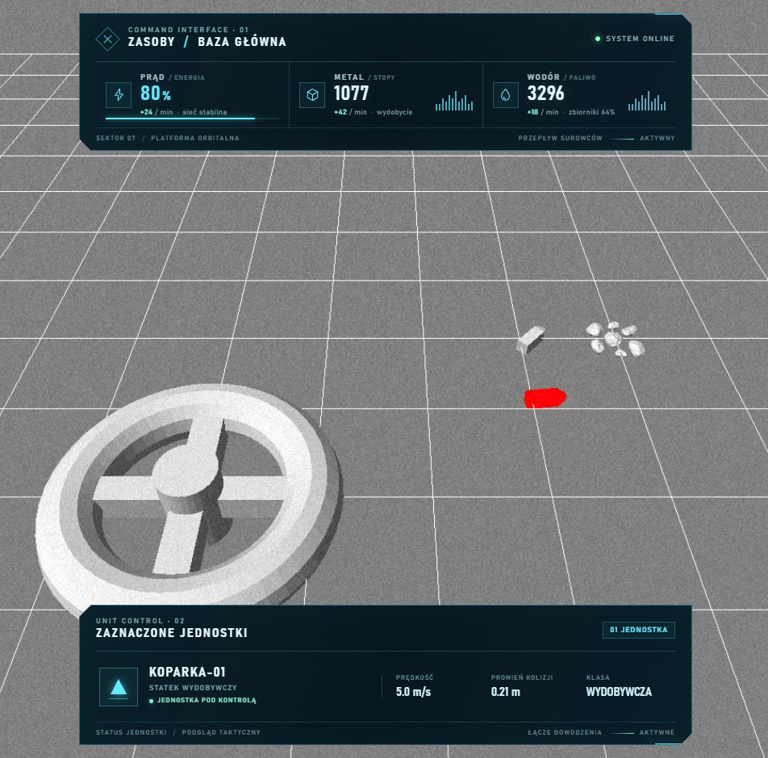

# _simpleWebGL
\
npm run server\
\
http://loclahost:3000

\
Przełączanie trybów: TAB\
\
W trybie TPP:
- mysz obraca statek w poziomie i pionie
- W/S uruchamiają napęd do przodu i do tyłu
- A/D przesuwają statek na boki, Q/E zmieniają wysokość
- Shift przyspiesza, a kółko myszy reguluje dystans kamery